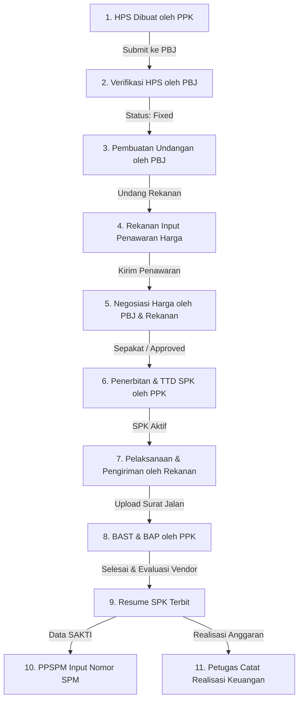

# 📘 PANDUAN PENGGUNA SENADA
### Sistem Pengadaan Barang dan Jasa Pemerintah

Selamat datang di **SENADA (Sistem Pengadaan Barang dan Jasa)** — platform web digitalisasi pengadaan barang dan jasa instansi terpadu. Sistem ini mengintegrasikan seluruh tahapan pengadaan mulai dari penyusunan Harga Perkiraan Sendiri (HPS), penerbitan undangan ke rekanan, negosiasi harga, penerbitan Surat Perintah Kerja (SPK), serah terima barang/jasa, hingga integrasi data pelaporan keuangan dan SPM SAKTI.

---

## 📑 Daftar Isi
1. [Prinsip & Alur Kerja Pengadaan (End-to-End)](#1-prinsip--alur-kerja-pengadaan-end-to-end)
2. [Akses Sistem & Akun Demo Siap Pakai](#2-akses-sistem--akun-demo-siap-pakai)
3. [Panduan Operasional Tiap Peran (Role Walkthrough)](#3-panduan-operasional-tiap-peran-role-walkthrough)
   - [A. PPK (Pejabat Pembuat Komitmen)](#a-ppk-pejabat-pembuat-komitmen)
   - [B. PBJ (Pejabat Pengadaan)](#b-pbj-pejabat-pengadaan)
   - [C. Penyedia / Rekanan (Vendor)](#c-penyedia--rekanan-vendor)
   - [D. PPSPM (Pejabat Penandatangan SPM)](#d-ppspm-pejabat-penandatangan-spm)
   - [E. Petugas Laporan Realisasi](#e-petugas-laporan-realisasi)
   - [F. Administrator](#f-administrator)
4. [Fitur Unggulan Sistem](#4-fitur-unggulan-sistem)
5. [Tanya Jawab & Penyelesaian Masalah (FAQ & Troubleshooting)](#5-tanya-jawab--penyelesaian-masalah-faq--troubleshooting)

---

## 1. Prinsip & Alur Kerja Pengadaan (End-to-End)

SENADA menerapkan sistem **State Machine** berurutan tanpa mengizinkan lompat tahap demi menjaga akuntabilitas dokumen dan audit trail:

### Aturan Pokok:
- **Zero Public Page**: Seluruh halaman wajib login (kecuali `/login`).
- **Role-Based Access Control (RBAC)**: Setiap pengguna hanya memiliki akses ke menu dan aksi yang sesuai dengan wewenang resminya.
- **Integritas Rincian Barang**: Item, spesifikasi, dan volume yang telah dikunci pada HPS bersifat tetap (*fixed*) dan menjadi acuan mutlak pada penawaran rekanan hingga SPK.
- **Audit Trail**: Setiap perubahan status, tanda tangan, dan pengajuan harga dicatat otomatis ke log audit internal.

---

## 2. Akses Sistem & Akun Demo Siap Pakai

Aplikasi dapat diakses melalui browser:
- **URL Produksi (Web Cloud)**: `https://senada-gray.vercel.app` *(atau URL Vercel instansi Anda)*
- **URL Lokal**: `http://localhost:5173`

Untuk mempermudah pengujian alur bisnis, gunakan akun-akun percontohan berikut:

| Peran (Role) | Email Login | Password Default | Wewenang Pokok |
|---|---|---|---|
| **Super Admin** | `admin@senada.go.id` | `Admin#SENADA2026` | Kelola akun, verifikasi vendor, audit log, konfigurasi sistem |
| **PPK** | `ppk@senada.go.id` | `Ppk12345!` | Buat HPS, terbitkan & TTD SPK, buat BAST/BAP, evaluasi vendor |
| **PBJ** | `pbj@senada.go.id` | `Pbj12345!` | Verifikasi HPS, buat undangan pengadaan, negosiasi harga |
| **Penyedia** | `vendor1@test.com` | `Vendor123!` | Kelola profil, terima undangan, input penawaran harga, respon nego |
| **PPSPM** | `ppspm@senada.go.id` | `Ppspm12345!` | Tinjau Resume SPK, catat referensi nomor SPM hasil aplikasi SAKTI |
| **Petugas Laporan** | `petugas@senada.go.id` | `Petugas12345!` | Tinjau Resume SPK, input data realisasi penyerapan anggaran |

---

## 3. Panduan Operasional Tiap Peran (Role Walkthrough)

### A. PPK (Pejabat Pembuat Komitmen)
Sebagai pemilik paket pengadaan, PPK bertanggung jawab menginisiasi pengadaan dan menyelesaikan kontrak.

#### 1. Menyusun Paket HPS (`/hps`)
1. Masuk menggunakan akun PPK.
2. Pada navbar atas, klik menu **HPS**.
3. Klik tombol **"+ Buat Paket HPS Baru"** di sudut kanan atas.
4. Isi informasi umum paket:
   - **Nama Paket Pengadaan** (misal: *Pengadaan Meubelair Ruang Arsip*).
   - **Tahun Anggaran** (misal: *2026*).
   - **Deskripsi Paket** dan data anggaran DIPA/POK.
5. Menambahkan Rincian Barang/Jasa:
   - **Cara Manual**: Klik *Tambah Item Barang*, masukkan nama barang, spesifikasi, satuan (unit/buah/set), volume, dan harga satuan perkiraan. Subtotal akan dihitung otomatis.
   - **Cara Import Excel**: Klik tombol *Import Excel*, pilih file format spreadsheet (contoh template tersedia di repositori: `HPS Pengadaan Meubelair Ruang Arsip, dll OK.xlsx`). Sistem akan mengekstrak seluruh baris secara otomatis.
6. Klik **"Simpan sebagai Draft"** untuk menyimpan sementara, atau **"Ajukan Verifikasi ke PBJ"** jika data sudah lengkap.

#### 2. Menerbitkan Surat Pesanan / SPK (`/spk`)
*(Dilakukan setelah negosiasi disetujui oleh PBJ dan Vendor)*
1. Klik menu **SPK**.
2. Paket yang negosiasinya telah disepakati akan muncul dengan status *Siap Terbit SPK*.
3. Klik **"Buat SPK"**, masukkan nomor dokumen resmi SPK, tanggal mulai, dan tanggal selesai pekerjaan.
4. Klik **"Tanda Tangan & Terbitkan SPK"** (tersedia opsi cetak PDF dengan ruang meterai fisik).

#### 3. Menerbitkan Berita Acara Serah Terima (BAST) & BAP (`/serah-terima`)
1. Setelah penyedia menyelesaikan pekerjaan dan mengunggah surat jalan, buka menu **Serah Terima**.
2. Klik detail paket yang diajukan.
3. Periksa kesesuaian fisik dan dokumen lampiran penyedia.
4. Klik **"Setujui & Terbitkan BAST"** serta **"Terbitkan BAP"**.
5. Isi formulir **Penilaian Kinerja Penyedia** (Kualitas, Ketepatan Waktu, dan Layanan skala 1-5).
6. Status SPK resmi berubah menjadi **Completed** dan Resume SPK diteruskan ke bagian keuangan.

---

### B. PBJ (Pejabat Pengadaan)
PBJ bertindak sebagai pelaksana teknis pemilihan rekanan dan negosiasi harga.

#### 1. Memverifikasi HPS (`/hps`)
1. Masuk menggunakan akun PBJ, buka menu **Verifikasi HPS**.
2. Klik paket HPS berstatus *Draft Diajukan*.
3. Periksa kewajaran harga satuan tiap item barang.
4. Jika sesuai, klik **"Setujui & Kunci HPS (Fixed)"**. HPS yang berstatus *Fixed* siap dijadikan dasar undangan.

#### 2. Menerbitkan Undangan Pengadaan (`/undangan`)
1. Buka menu **Undangan**, klik **"+ Buat Undangan Baru"**.
2. Pilih paket HPS yang telah berstatus *Fixed*. Nomor undangan akan terisi otomatis.
3. Tentukan batas akhir tanggal & waktu pemasukan penawaran.
4. Pilih penyedia rekanan terdaftar yang akan diundang (dapat memilih satu atau lebih rekanan).
5. Klik **"Kirim Undangan"**. Notifikasi undangan akan masuk ke akun rekanan terpilih.

#### 3. Mengevaluasi Penawaran & Menjalankan Negosiasi (`/penawaran` & `/negosiasi`)
1. Buka menu **Penawaran** untuk melihat dokumen penawaran harga yang masuk dari vendor.
2. Buka menu **Negosiasi** untuk memulai putaran negosiasi:
   - Klik **"Buka Negosiasi"**.
   - Masukkan **Harga Usulan Negosiasi** yang ditargetkan beserta catatan klarifikasi harga.
   - Klik **"Kirim Usulan Nego"**.
   - Tunggu respon persetujuan dari penyedia.

---

### C. Penyedia / Rekanan (Vendor)
Rekanan adalah pihak eksternal yang diundang untuk memasukkan penawaran dan melaksanakan pekerjaan.

#### 1. Melengkapi Profil Perusahaan (`/vendor/profil`)
1. Masuk menggunakan akun Penyedia.
2. Periksa kelengkapan identitas perusahaan, NPWP, alamat kantor, rekening bank, serta dokumen legalitas.

#### 2. Menerima Undangan & Mengunduh Format Penawaran (`/undangan`)
1. Buka menu **Undangan Masuk**.
2. Klik undangan pengadaan yang diterima.
3. Klik tombol **"Unduh Rincian Penawaran (Cetak/PDF)"** untuk mencetak daftar barang acuan HPS.
4. Berikan tanda tangan basah dan cap stempel perusahaan pada dokumen fisik.

#### 3. Menginput Penawaran Harga (`/penawaran`)
1. Klik **"Kirim Penawaran"**.
2. Masukkan harga satuan penawaran untuk masing-masing item (spesifikasi dan volume terkunci otomatis mengikuti HPS).
3. Unggah file scan penawaran berstempel/bertandatangan.
4. Klik **"Kirimkan Penawaran Resmi"**.

#### 4. Merespon Negosiasi Harga (`/negosiasi`)
1. Buka menu **Negosiasi**.
2. Jika ada usulan harga baru dari PBJ, tinjau nominal yang diusulkan.
3. Klik tombol **"Setuju (Accept)"** untuk menyepakati harga akhir, atau **"Tolak (Reject)"** jika keberatan.

#### 5. Melaksanakan Pekerjaan & Upload Bukti Kirim (`/serah-terima`)
1. Setelah SPK terbit, buka menu **Pengiriman**.
2. Setelah barang/jasa diserahkan ke instansi, klik **"Upload Dokumen Pengiriman"**.
3. Unggah scan Surat Jalan, Berita Acara Lapangan, atau Izin Mulai Kerja.
4. Tunggu verifikasi dan penerbitan BAST oleh PPK.

---

### D. PPSPM (Pejabat Penandatangan SPM)
Bagian keuangan yang memvalidasi dokumen pembayaran untuk penerbitan Surat Perintah Membayar (SPM).

1. Masuk menggunakan akun PPSPM, buka menu **Resume SPK** atau **Laporan**.
2. Pada tab **Resume SPK**, periksa paket-paket yang telah selesai serah terima (lengkap dengan nilai kontrak riil, penyedia, nomor BAST, dan BAP).
3. Buka tab **SPM Reference**:
   - Gunakan data rincian Resume SPK untuk memproses penerbitan SPM pada aplikasi eksternal kementerian (**SAKTI**).
   - Setelah nomor SPM terbit di SAKTI, klik **"Input Referensi SPM"** di SENADA.
   - Masukkan Nomor SPM dan Tanggal SPM sebagai tanda integrasi administrasi keuangan selesai.

---

### E. Petugas Laporan Realisasi
Petugas pembukuan realisasi pengeluaran anggaran instansi.

1. Masuk menggunakan akun Petugas Laporan, buka menu **Laporan**.
2. Tinjau daftar resume SPK yang telah selesai serah terima.
3. Pada tab **Laporan Realisasi Anggaran**, klik **"Input Realisasi"**:
   - Masukkan nominal realisasi pembayaran kas.
   - Masukkan tanggal pembukuan dan catatan pencairan.
4. Klik **"Simpan Realisasi"**. Grafik serapan anggaran di Dashboard instansi akan terbarui secara otomatis.

---

### F. Administrator
Pengelola teknis hak akses dan keamanan aplikasi.

1. **User Management (`/admin/users`)**: Menambah pegawai baru, mereset password, mengaktifkan/menonaktifkan akun.
2. **Verifikasi Vendor (`/admin/vendors`)**: Memeriksa berkas pendaftaran calon penyedia baru sebelum diizinkan menerima undangan paket pengadaan.
3. **Audit Log (`/admin/audit-logs`)**: Memantau rekam jejak aktivitas kritis di sistem secara *real-time* (siapa yang mengubah harga, menyetujui nego, menandatangani SPK, beserta alamat IP dan waktu eksekusi).

---

## 4. Fitur Unggulan Sistem

- **Tampilan Antarmuka Modern & Premium**: Menggunakan standar desain *clean navy & white* profesional dengan navigasi cepat berbasis Single Page Application (React + Vite).
- **Import Dokumen Excel Otomatis**: Membaca file `.xlsx` HPS instansi secara langsung tanpa perlu input baris manual satu per satu.
- **Export & Cetak PDF Lengkap**: Sedia format cetak siap tanda tangan dan meterai untuk SPK, BAST, BAP, dan Resume Eksekutif.
- **Evaluasi Kinerja Vendor Berkelanjutan**: Rating skor performa rekanan tercatat otomatis untuk referensi pengadaan selanjutnya.
- **Sistem Keamanan Berlapis**: Token JWT bertaraf industri, httpOnly refresh cookie, rate limiting anti brute-force, dan proteksi SQL Injection melalui Sequelize ORM.

---

## 5. Tanya Jawab & Penyelesaian Masalah (FAQ & Troubleshooting)

### ❓ Mengapa muncul pesan *"Akses ditolak. Anda tidak memiliki izin untuk melakukan tindakan ini (403)"*?
**Jawaban:**
Pesan ini muncul jika akun Anda mencoba membuka menu di luar wewenang perannya (misal: Penyedia mencoba membuat HPS, atau PPK membuka verifikasi vendor). Jika Anda membuka menu yang seharusnya berhak diakses (seperti PPK membuka HPS):
1. Pastikan Anda telah me-refresh halaman browser.
2. Jika database baru saja dimigrasikan, panggil endpoint inisialisasi:
   `https://senada-node-f4-khr-1-s-projects.vercel.app/api/setup/init-db?force=true`
3. Lakukan logout lalu login kembali untuk memperbarui token izin akun Anda.

### ❓ Bagaimana jika halaman pertama kali dibuka terasa lambat (loading beberapa detik)?
**Jawaban:**
Pada versi cloud Vercel serverless gratis, server database akan masuk ke mode *sleep (idle)* jika tidak ada aktivitas selama beberapa saat (*cold start*). Begitu ada permintaan masuk, server akan aktif kembali dan seluruh request berikutnya akan berjalan sangat cepat dan lancar.

### ❓ Apakah nomor SPM dibuat langsung oleh aplikasi SENADA?
**Jawaban:**
Tidak. Sesuai regulasi keuangan negara, penerbitan SPM resmi diproses melalui aplikasi **SAKTI** milik Kementerian Keuangan. SENADA berfungsi sebagai penyedia data rujukan SPK & BAST yang valid (*single source of truth*) dan mencatat kembali nomor SPM hasil SAKTI agar rekam jejak pengadaan lengkap dari hulu ke hilir.

---

*SENADA — Sistem Pengadaan Barang dan Jasa Digital Instansi.*
*Dokumentasi ini dikelola secara berkala bersama kode program.*
